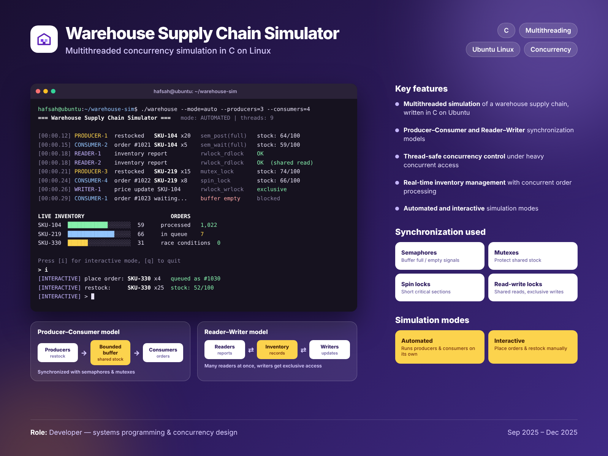
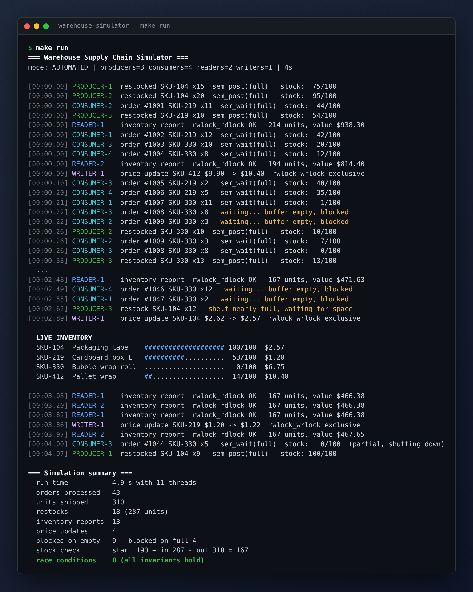
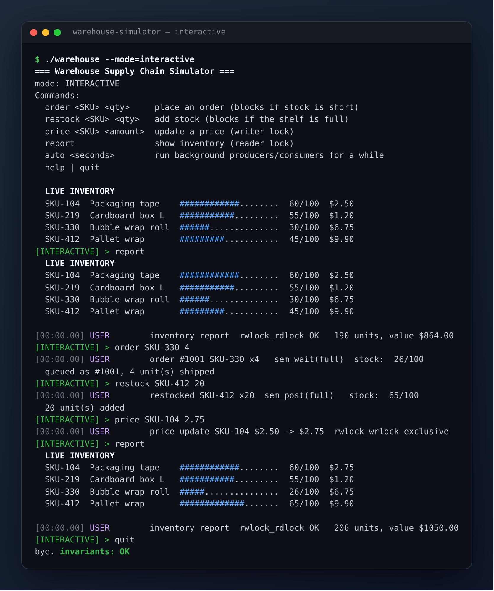
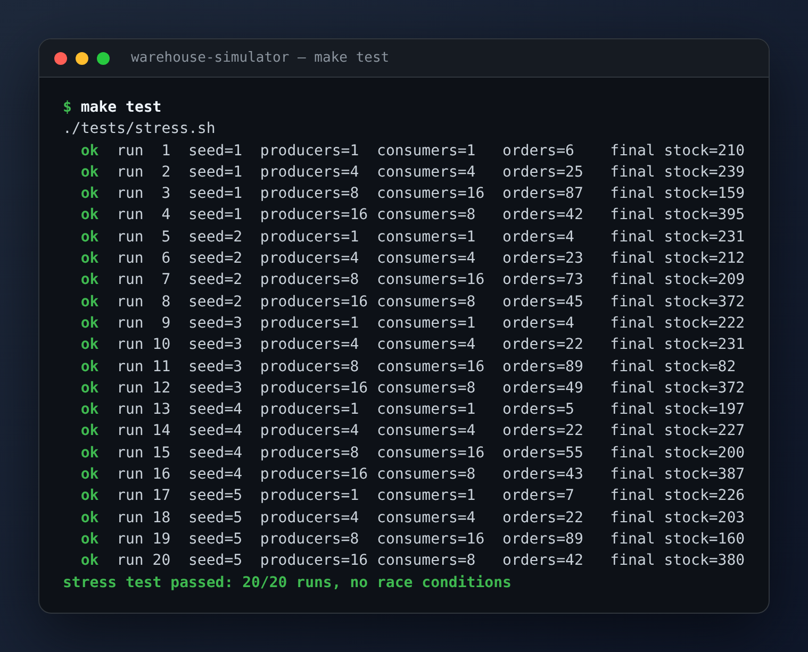
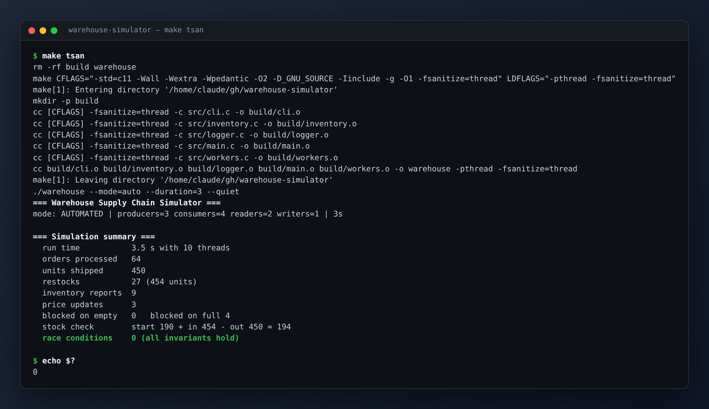

# Warehouse Supply Chain Simulator

A multithreaded warehouse simulation written in **C** with **POSIX threads** on **Linux**.
Producers restock shelves, consumers fulfil orders, report threads read inventory and
price threads update records — all at the same time, without race conditions.



## Highlights

- **Producer–Consumer model** — each SKU is a bounded buffer guarded by counting semaphores (`full` / `empty`) and a mutex
- **Reader–Writer model** — inventory reports share a read lock; price updates take an exclusive write lock
- **Spin locks** for tiny critical sections (shared statistics) and **C11 atomics** for order ids and the stop flag
- **Automated mode** with a live inventory dashboard, and an **interactive mode** to place orders and restock by hand
- **Self-checking**: every run verifies stock and semaphore invariants and reports `race conditions: 0`
- **Stress tests** and a **ThreadSanitizer** build in CI

## Build and run

Requires `gcc` (or `clang`), `make` and a POSIX system (Linux, WSL or macOS).

```bash
make                       # build ./warehouse
make run                   # 3 producers, 4 consumers, 5 seconds
make interactive           # type commands yourself
make test                  # 20 stress runs with up to 30 threads
make tsan                  # ThreadSanitizer build and run
```

### Options

```
./warehouse --mode=auto|interactive --producers=N --consumers=N
            --readers=N --writers=N --duration=SEC --seed=N --quiet
```

### Sample output

```
=== Warehouse Supply Chain Simulator ===
mode: AUTOMATED | producers=3 consumers=4 readers=2 writers=1 | 5s

[00:00.12] PRODUCER-1  restocked SKU-104 x20  sem_post(full)   stock:  80/100
[00:00.15] CONSUMER-2  order #1021 SKU-104 x5   sem_wait(full)  stock:  75/100
[00:00.18] READER-1    inventory report  rwlock_rdlock OK   187 units, value $716.31
[00:00.26] WRITER-1    price update SKU-104 $2.50 -> $2.62  rwlock_wrlock exclusive
[00:00.29] CONSUMER-1  order #1023 SKU-330 x9   waiting... buffer empty, blocked

=== Simulation summary ===
  orders processed   37
  units shipped      260
  restocks           16 (244 units)
  stock check        start 190 + in 244 - out 260 = 174
  race conditions    0 (all invariants hold)
```

### Interactive commands

```
order <SKU> <qty>      place an order (blocks if stock is short)
restock <SKU> <qty>    add stock (blocks if the shelf is full)
price <SKU> <amount>   update a price (writer lock)
report                 show inventory (reader lock)
auto <seconds>         run producers and consumers in the background for a while
quit
```

## Screenshots

Real terminal output from the four ways of running the project.

**Automated mode** (`make run`): producers, consumers, report readers and a price writer all running at once, with blocking on empty/full shelves, a live inventory view and an end-of-run invariant check.



**Interactive mode** (`make interactive`): place orders, restock, change prices and print reports by hand.



| Stress test (`make test`): 20 runs, up to 16x8 threads | ThreadSanitizer build (`make tsan`): no data races |
|---|---|
|  |  |

## Project structure

```
include/   headers (inventory, workers, logger, config)
src/
  inventory.c   shelves, semaphores, locks and invariant checks
  workers.c     producer, consumer, reader, writer and monitor threads; both modes
  logger.c      thread-safe, timestamped logging
  cli.c         argument parsing
  main.c        entry point
tests/stress.sh 20 heavy runs that must all pass
docs/design.md  synchronization design
```

See [docs/design.md](docs/design.md) for how each lock is used.

## Author

**Hafsah Zulfiqar** — systems programming and concurrency design (Sep 2025 – Dec 2025)
